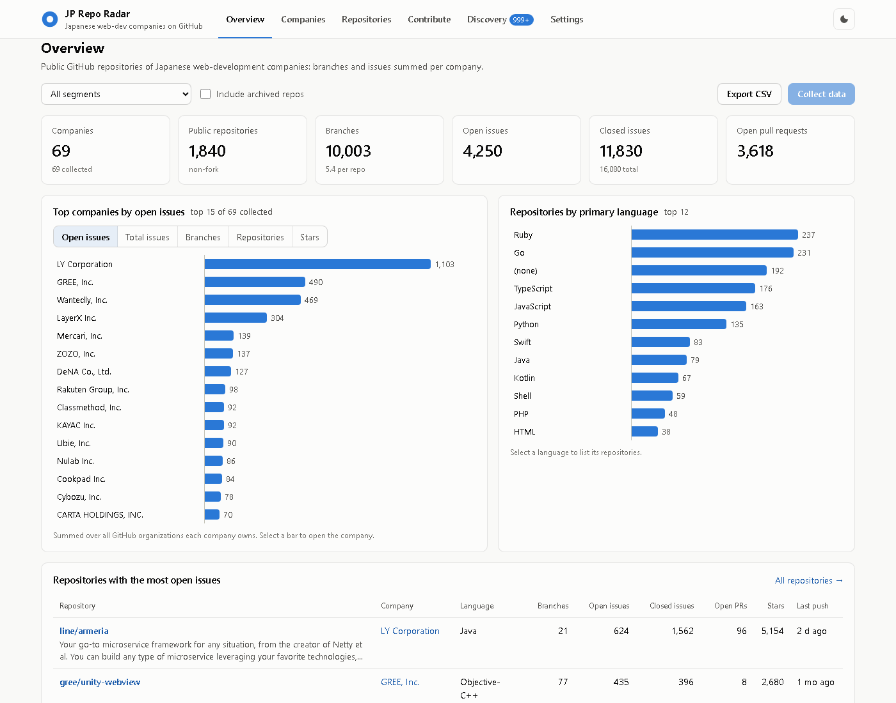
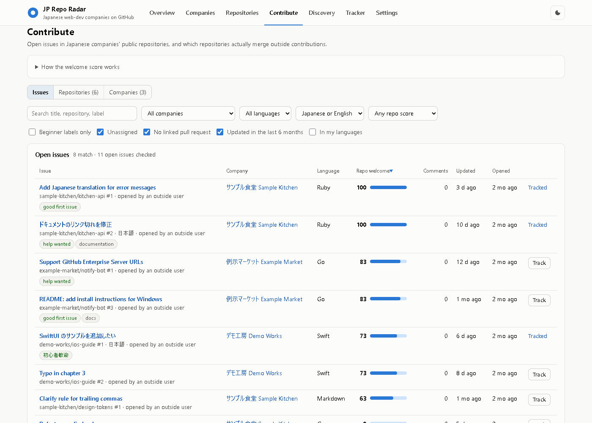
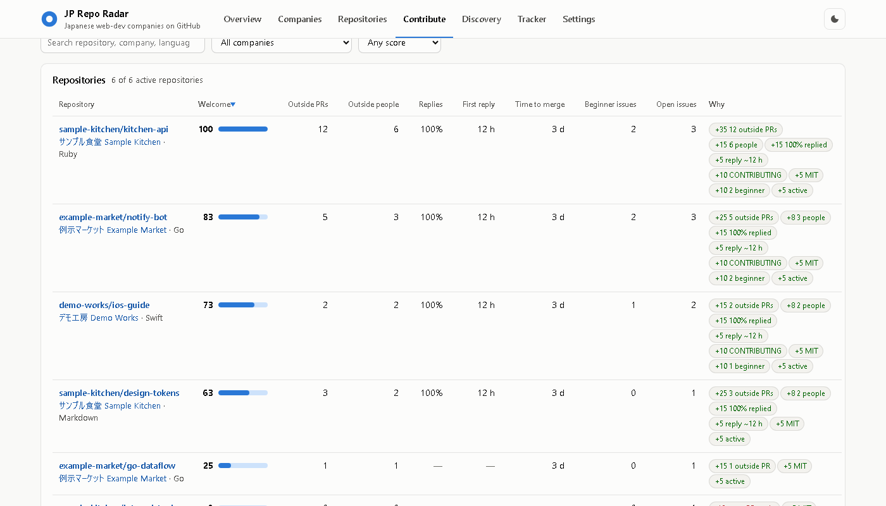
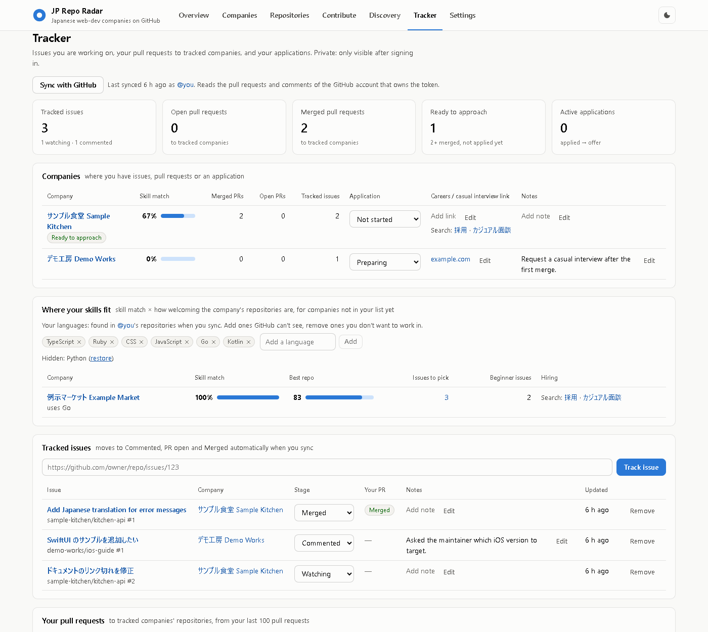
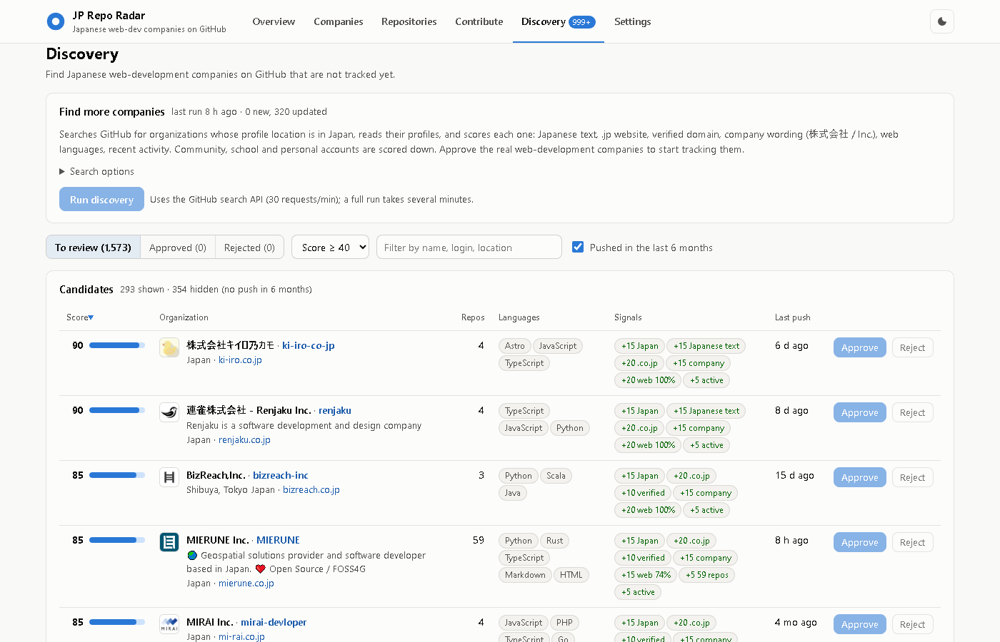

# JP Repo Radar

[](https://github.com/codebelle8/jp-repo-radar/actions/workflows/ci.yml)

English: [README.md](README.md)

**日本の Web 開発企業の公開 GitHub リポジトリ**を集計するダッシュボードです。
「どの企業の OSS が外部からのコントリビューションを本当に受け入れていて、自分は何に取り組めるか」を調べるために作りました。

**公開中:** <https://jp-repo-radar.vercel.app>（69 社・約 1,800 リポジトリ、毎日自動更新）



## 機能

| ページ | 内容 |
|---|---|
| **概要・企業・リポジトリ** | 企業ごとに、所有するすべての GitHub Organization を合算したブランチ数、Issue 数（オープン / クローズ）、オープン PR 数、スター数。推移グラフ、CSV 出力。 |
| **Contribute** | 新しく参加する人が取り組める Issue（担当者なし、紐づく PR なし、最近更新あり）。各リポジトリの **歓迎度スコア**（0〜100）は、直近 12 か月の実績から計算します：外部 PR のマージ数、外部コントリビューター数、外部からの Issue への返信率と返信の速さ、CONTRIBUTING、ライセンス、初心者向けラベル。 |
| **Discovery** | GitHub 上で日本の Organization をさらに検索し、企業らしさ（コミュニティや大学ではないか）をスコア化して承認待ちに並べます。 |
| **Tracker**（非公開） | 取り組み中の Issue を GitHub 上の活動から自動で進めます（ウォッチ → コメント → PR オープン → マージ）。企業ごとの自分の PR と応募状況を管理し、マージ済み PR が 2 件になった企業には「アプローチ可能」の目印を付けます。 |
| **English / 日本語** | すべての画面・メッセージ・グラフを英語と日本語で表示します。ヘッダーの国旗ボタンで切り替えられ、選択はブラウザごとに保存されます。初回はブラウザの言語設定に合わせます。 |
| **自動修正**（非公開） | Issue のリンクを貼ると、Claude Managed Agents があなたのフォークで修正し、テストを実行してブランチをプッシュします。差分と解説を確認したら、ボタン 1 つでプルリクエストを作成できます。そのプルリクエストへのレビュー、コメント、CI の失敗、マージはアプリ内の通知で届き、レビューへの対応もエージェントに任せられます。 |
| **スキルマッチ**（非公開） | 自分の GitHub リポジトリから使用言語を検出し、各企業の技術スタックと比較します。スキルマッチと歓迎度スコアの高い企業を提案します。 |

| Contribute：取り組める Issue | Contribute：リポジトリの歓迎度 |
|---|---|
|  |  |
| **Tracker**（サンプルデータ） | **Discovery** |
|  |  |

## 技術的なポイント

- **サーバーレスで長時間ジョブを実行**：全 Organization の収集には数分かかりますが、Vercel の関数は数十秒で終了します。
  そこでジョブを保存し、ロックをかけたうえで約 40 秒ずつ進めます。進捗は Organization ごとに保存します。
  次のステップは、ダッシュボードを開いているタブ、毎日の Cron、CLI のどれからでも進められます。
  GitHub のレート制限に達した場合は、リセット時刻まで待ってから自動で再開します。
- **GraphQL の一括取得とバッチサイズの自動調整**：エイリアスで 1 リクエストあたり 10 リポジトリを取得します。
  GitHub がタイムアウトした場合は 5 → 2 → 1 件に減らして再試行します。クエリは GitHub が公開しているスキーマで検証済みです。
- **1 つのストレージインターフェースに 3 つのドライバー**：Postgres（Neon）、Upstash Redis、ローカル JSON ファイル。
  ローカルでは設定なしで動き、Vercel ではワンクリックで永続化できます。
- **必要なところは非公開に**：公開ページは閲覧専用です。書き込みには同一オリジンの JSON リクエストと署名付き HttpOnly
  Cookie が必要です。Tracker とスキルの API は、サインインしていない訪問者には 401 を返します。GitHub トークンがブラウザに渡ることはありません。
- **ライブラリを使わない多言語化**：英語の文言をキーにして、日本語を `lib/i18n/` に置いています。数値などを含むサーバーのメッセージ（ジョブの進捗、スコアの根拠、エラー）は正規表現で照合します。
  画面で `t()` に渡した文言に日本語訳がない場合や、訳文でプレースホルダーが抜けた場合はテストが失敗します。
- **ネットワークなしでテスト**：偽の GitHub（エラー、502、レート制限も再現）、偽の Upstash、PGlite による Postgres を使い、
  `npm test` で検証します。CI ではプッシュのたびにテストと本番ビルドを実行します。

使用技術：Next.js 16（App Router）、React 19、JavaScript、`@neondatabase/serverless`、`node:test`。
グラフと表は自作で、UI ライブラリやチャートライブラリは使っていません。

## 自動修正のしくみ

1. **事前チェック**：Issue がオープンか、担当者や解決済みのプルリクエストがないか、最近「やります」と言った人がいないかを確認します。
2. **フォーク**：書き込み用トークンでフォークします。試行ごとに新しいブランチ名を使うので、既存のものは上書きしません。
3. **セッション**：Claude Managed Agents（`claude-opus-5-5`）がフォークを使って作業します。トークンは隔離環境に入らず、通信はパッケージの配布元だけに制限し、1 回あたりの費用に上限（初期値 5 ドル）を設けています。Issue の本文は「指示」ではなく「データ」として渡します。
4. **結果**：エージェントが `result.json`（状態、日本語の解説、テスト結果、プルリクエストの文面）を書き、アプリが GitHub から差分を取得します。
5. **あなたの承認**：解説と差分を読んでからプルリクエストを作成します（`Fixes #番号` 付き、同じ企業へは 1 日 1 件まで）。それまでは何も公開されません。
6. **見守り**：レビュー、コメント、CI、マージを、ページを開いたとき・15 分ごと（GitHub Actions）・Anthropic の Webhook で確認し、アプリ内の通知（ヘッダーのベル）でお知らせします。

設定：Vercel に `ANTHROPIC_API_KEY` と `GITHUB_WRITE_TOKEN`（`public_repo` と `workflow` 付きのクラシックトークン）を追加し、自動修正ページの **エージェントを作成** を押します。

## ローカルで動かす

```bash
git clone https://github.com/codebelle8/jp-repo-radar.git
cd jp-repo-radar
npm install
npm run build && npm start      # または npm run dev
```

<http://127.0.0.1:3000> を開いて、次の手順で進めます：

1. <https://github.com/settings/personal-access-tokens/new> でトークンを作成します（「Public repositories (read-only)」のみ）。
2. **Settings** ページに貼り付けます（または `.env.local` に `GITHUB_TOKEN=...` と書きます）。
3. **Collect data** をクリックします。初回は数分かかります。

Vercel へのデプロイ、設定項目、各数値の意味は [README.md](README.md) を参照してください。

## ライセンス

[MIT](LICENSE)
