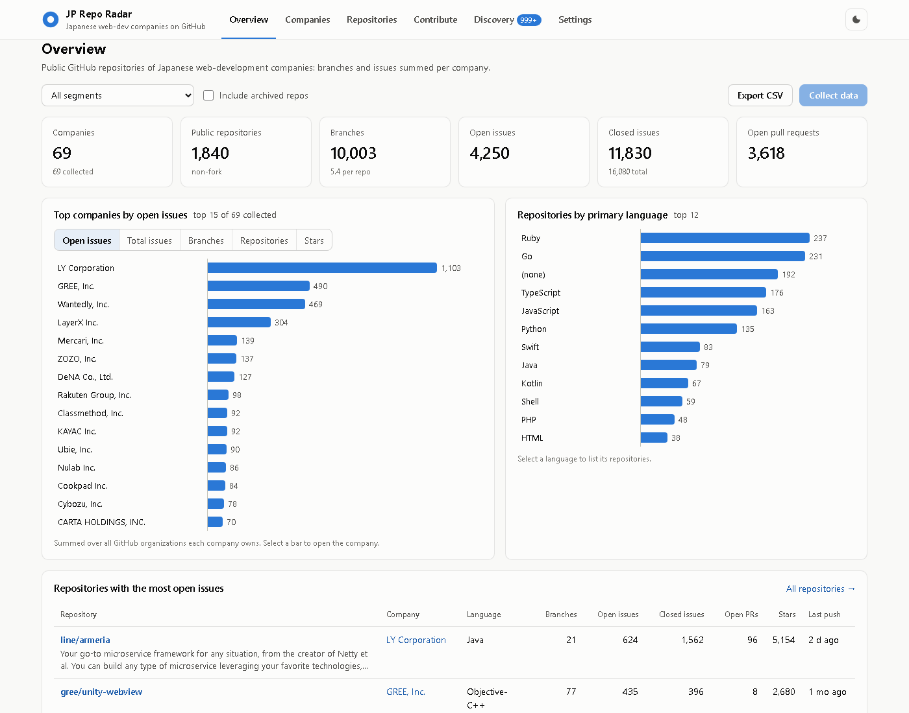
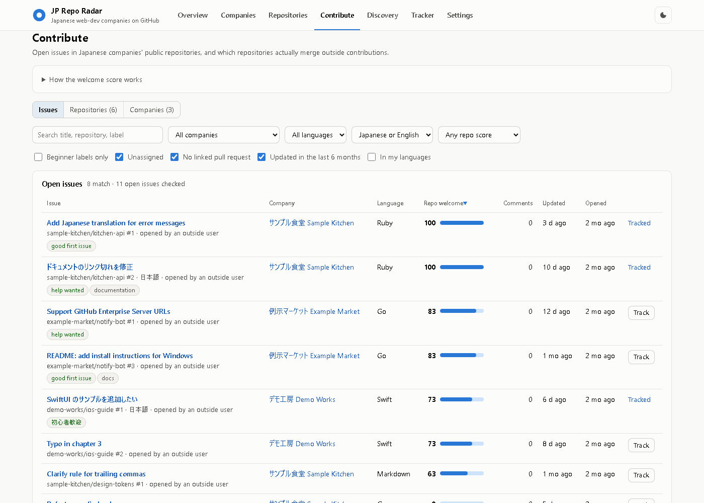
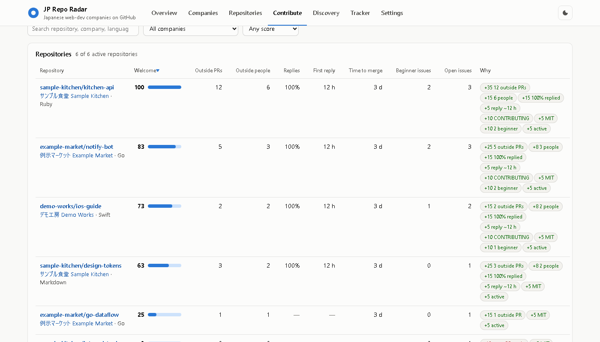
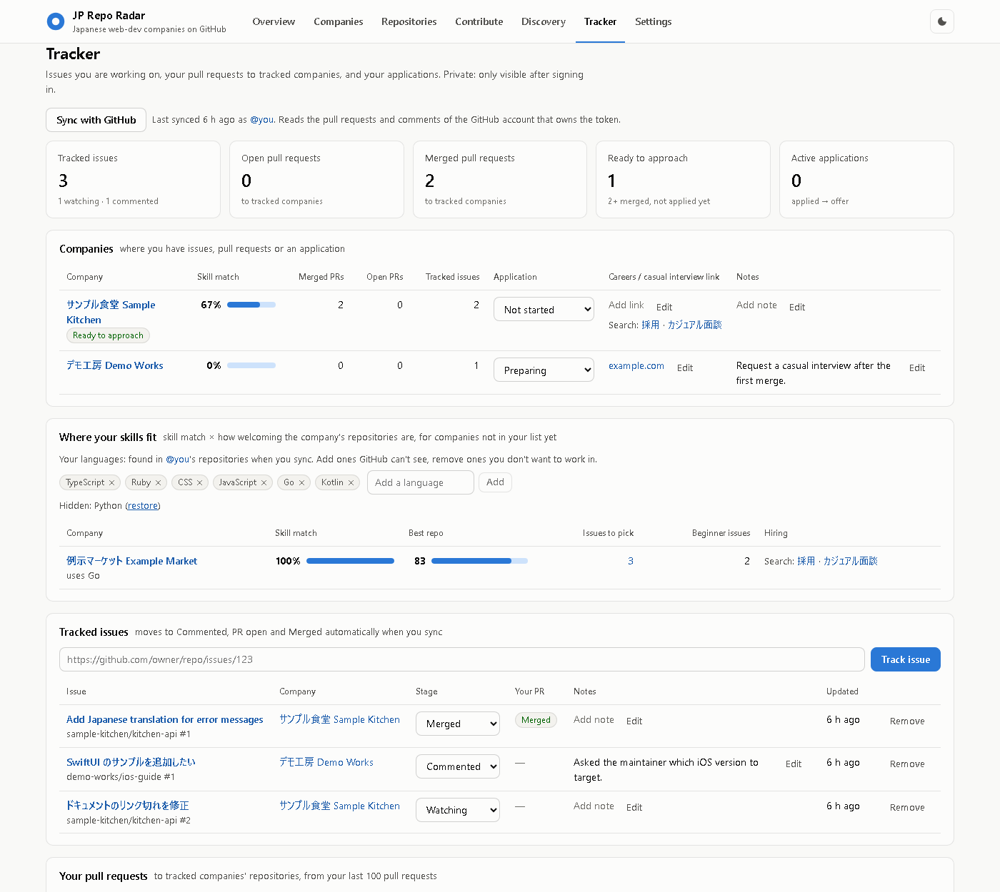
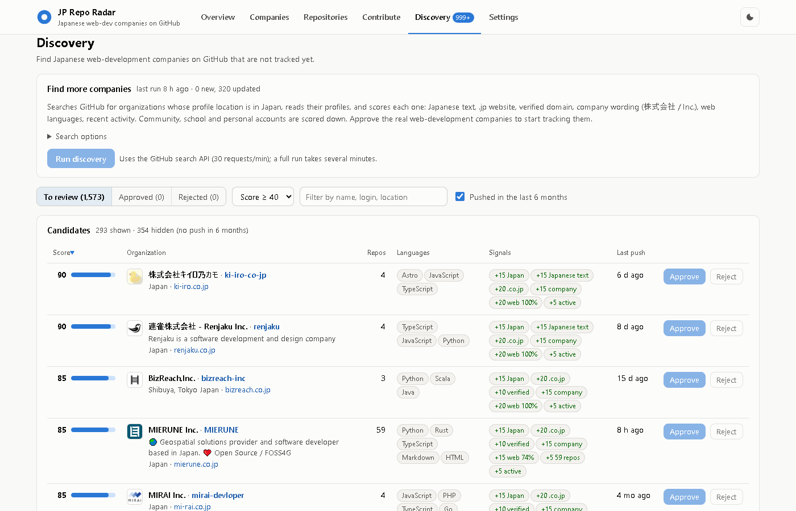
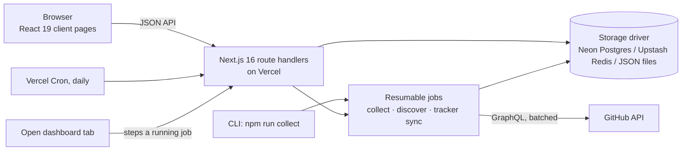

# JP Repo Radar

[](https://github.com/codebelle8/jp-repo-radar/actions/workflows/ci.yml)
[](LICENSE)

日本語版: [README.ja.md](README.ja.md)

A dashboard of the **public GitHub activity of Japanese web-development companies**, built to answer one question:
*which of their open-source projects actually welcome outside contributors, and what could I work on there?*

**Live:** <https://jp-repo-radar.vercel.app>. It covers 69 companies and their GitHub organizations, about 1,800 public
repositories, and refreshes daily.



## Features

| Page | What it shows |
|---|---|
| **Overview, Companies, Repositories** | Branches, open and closed issues, open pull requests and stars, summed per company over every GitHub organization it owns. Trend lines per company, CSV export. |
| **Contribute** | Open issues a newcomer could pick up (unassigned, no linked pull request, recently active), and a 0–100 **welcome score** per repository based on what it actually did in the last 12 months: outside pull requests merged, number of outside contributors, how often and how fast maintainers reply to outside issues, CONTRIBUTING guide, license, beginner labels. |
| **Discovery** | Searches GitHub for more Japanese organizations, scores whether each looks like a company (versus a community or a university), and queues them for approval. |
| **Tracker** (private) | Issues you are working on, moved forward automatically from your GitHub activity (watching → commented → PR open → merged). Your pull requests and application stage per company. A company is flagged *ready to approach* after 2 merged pull requests. |
| **Skill match** (private) | Your languages, detected from your GitHub repositories, compared with each company's stack. Suggests companies to contribute to, ranked by skill match and welcome score. |

| Contribute: issues to pick up | Contribute: welcome score per repository |
|---|---|
|  |  |
| **Tracker** (sample data) | **Discovery** |
|  |  |

## Architecture



- **Long jobs on short-lived serverless functions.** A collection over 77 organizations and about 1,800 repositories takes
  minutes, but a Vercel function call lasts seconds. Jobs are stored and advanced in small steps under a lock: about 40
  seconds of work per step, saving progress after each organization. Any tab with the dashboard open, the daily cron or
  the CLI can drive the next step. Closing the tab pauses the job; GitHub's rate limit pauses it until the reset time.
- **Batched GraphQL with adaptive batch size.** The contribution phase asks for 10 repositories per request using aliased
  fields. When GitHub times out on a heavy batch, it retries with 5, then 2, then 1. The queries were validated against
  GitHub's published GraphQL schema.
- **One storage interface, three drivers.** The same `get / set / hash / list / lock` interface runs on Postgres (Neon's
  HTTP driver), Upstash Redis (REST) and local JSON files, so it runs locally with zero setup and on Vercel with one
  click.
- **Private by default where it matters.** Public pages are read-only. Writes need same-origin JSON requests and a signed
  HttpOnly cookie. Tracker and skill endpoints answer 401 to visitors. The GitHub token never reaches the browser.
- **Tested without the network.** `npm test` runs a fake GitHub (fetch-compatible, including errors, 502s and rate limits),
  a fake Upstash server and real Postgres semantics through PGlite. CI runs the tests and a production build on every
  push.

Tech: Next.js 16 (App Router), React 19, plain JavaScript, `@neondatabase/serverless`, `node:test`. Charts and tables are
hand-written, with no UI or chart library.

## Run locally

```bash
git clone https://github.com/codebelle8/jp-repo-radar.git
cd jp-repo-radar
npm install
npm run build && npm start      # or: npm run dev
```

Open <http://127.0.0.1:3000>, then:

1. Create a GitHub token at <https://github.com/settings/personal-access-tokens/new>. Choose “Public repositories
   (read-only)”; no other permissions are needed. GitHub's GraphQL API needs a token even for public data.
2. Paste it on the **Settings** page, or put `GITHUB_TOKEN=...` in `.env.local` (see `.env.example`).
3. Click **Collect data**. Progress shows at the top of the page; the first run takes a few minutes.

## Deploy to Vercel

```bash
vercel                 # first time: creates and links the Vercel project, makes a preview deployment
```

Then, in the Vercel dashboard for the project:

1. **Storage → Create Database → Neon** (Postgres, free plan) or **Upstash for Redis** (free plan) → connect it to the
   project. Neon adds `DATABASE_URL`; Upstash adds `KV_REST_API_URL` and `KV_REST_API_TOKEN`. From the CLI:
   `vercel integration add neon --plan free_v3 -m region=iad1 -m auth=false --no-env-pull`.
   Without storage the site still works, but its data is temporary (a yellow banner says so).
2. **Settings → Environment Variables**, add:
   - `GITHUB_TOKEN`: the token from step 1 above (optional once storage is connected: you can paste it on the
     **Settings** page instead)
   - `ADMIN_PASSWORD`: needed to edit or run jobs from the browser (without it the deployment is read-only)
   - `CRON_SECRET`: any random string; Vercel sends it with the daily cron request
3. Deploy to production:

   ```bash
   vercel --prod
   ```

4. Open the site, sign in on **Settings** with `ADMIN_PASSWORD`, and click **Collect data**.

The cron in `vercel.json` runs daily at 18:00 UTC (03:00 JST) and refreshes everything. Vercel's free Hobby plan allows one
cron run per day.

## How collection works (and why it fits serverless)

Vercel functions are short-lived, so a collection is a **stored job advanced in small steps**:

- A step processes organizations for up to ~40 seconds, saving progress after each one, then returns.
- Anything can drive steps: an **open dashboard tab** (automatically, while a job is running), the **daily cron**
  (`/api/cron/collect`, up to 5 minutes per run), or the CLI (`npm run collect`).
- A lock ensures only one step runs at a time. If you close the tab, the job pauses and continues later.
- If GitHub's rate limit is reached, the job pauses until the reset time and then resumes by itself.
- Discovery works the same way. Its search requests are paced at GitHub's 30-per-minute search limit.

`/api/cron/collect` declares `maxDuration = 300`, which needs Vercel's Fluid compute (on by default for new projects). If your
project has it turned off, lower the value to 60 in `app/api/cron/collect/route.js`.

## What the numbers mean

| Column | Per repository, summed per company |
|---|---|
| Repos | Public, **non-fork** repositories of the company's GitHub organizations |
| Branches | `refs/heads/*` count |
| Open / closed issues | Issues only; pull requests are **not** counted |
| Open PRs | Open pull requests |

### Contribute page

Each collection also checks every **active** repository (not archived, pushed in the last 12 months, up to 60 per
organization) for:

- **Open issues** (the 30 most recently updated per repository) with labels, assignee, comment count and whether an open
  pull request already links to them. Defaults show issues that are unassigned, have no linked pull request and were updated
  in the last 6 months.
- A 0–100 **welcome score**: outside pull requests merged in the last 12 months, number of outside contributors, how often and
  how fast maintainers reply to issues opened by outside users, CONTRIBUTING guide, license, beginner-labelled issues, recent
  pushes. "Outside" means not an owner, member or collaborator; bots are excluded. GitHub reports employees with private
  organization membership as outside contributors, so outside counts can include some staff.

### Tracker (private)

Visible only after signing in (the tab is hidden and its API answers 401 otherwise). Track issues from the Contribute page or
by pasting an issue link. **Sync with GitHub** (automatic when the page opens and the last sync is over 30 minutes old, and
daily with the cron) reads the token owner's last 100 pull requests and recent issue comments, then:

- moves tracked issues forward: watching → commented → PR open → merged (never backwards, never out of "dropped");
  a pull request counts for an issue when it closes it ("Fixes #123");
- counts your open and merged pull requests per tracked company and flags a company **Ready to approach** after 2 merged
  pull requests while your application is still "Not started" or "Preparing";
- keeps an application stage, careers / casual interview link and notes per company (with search links for the company's
  engineering hiring page and casual interviews until you save one);
- detects **your languages** (10%+ of the code in one of your own non-fork repositories, or the main language of a repository you
  committed or opened pull requests to). You can add languages GitHub can't see and hide detected ones.

**Skill match** (0–100%) is the share of a company's active repositories (pushed in the last 12 months) whose main language is one
of yours; related languages (TypeScript / JavaScript, Kotlin / Java, Vue / TypeScript …) count half. It appears on the Tracker and
on Contribute → Companies when you are signed in. **Where your skills fit** ranks companies with open issues by skill match (60%)
and the welcome score of their best repository (40%). Contribute → Issues gets an **In my languages** filter.

Archived repositories are excluded unless you tick **Include archived repos**. Each collection also records per-company
totals, so the company page shows trend lines after the second run.

Most companies keep product code private, so these numbers describe open-source and public activity, not total engineering
output.

## Command line

```bash
npm run collect                              # collect all companies (same storage as the app)
npm run collect -- --company cookpad         # one company (repeatable)
npm run discover -- --min-repos 5 --location Tokyo
npm test                                     # unit tests (GitHub and Upstash faked, Postgres via PGlite)
```

## Configuration

| Variable | Where | Purpose |
|---|---|---|
| `GITHUB_TOKEN` | `.env.local` / Vercel | GitHub API token (can also be saved from Settings unless storage is temporary) |
| `ADMIN_PASSWORD` | optional locally, needed on Vercel | Sign-in for editing and running jobs |
| `CRON_SECRET` | Vercel | Protects `/api/cron/collect` |
| `KV_REST_API_URL`, `KV_REST_API_TOKEN` | added by Vercel's Upstash integration | Redis storage (`UPSTASH_REDIS_REST_URL` / `_TOKEN` also work); takes priority |
| `DATABASE_URL` | added by Vercel's Neon integration | Postgres storage (`POSTGRES_URL` also works); tables `jprr_*` are created automatically |
| `DATA_DIR` | optional | Local data folder (default `./data`) |
| `STORE_PREFIX` | optional | Redis key prefix (default `jprr:`) |

## Security

- Without `ADMIN_PASSWORD`, editing is only open locally (the server binds to `127.0.0.1`). On Vercel, editing needs
  `ADMIN_PASSWORD` plus sign-in, which sets an HttpOnly, SameSite=Strict cookie.
- Write requests must be same-origin JSON. Locally, requests addressed to other host names are refused.
- The GitHub token is never sent to the browser.

## Project layout

```
app/                    pages (React) and API routes (app/api/*/route.js)
components/             UI: app shell, providers (status, job runner, tooltip), charts, tables, forms
lib/
  store.js              picks storage: Upstash Redis (store-redis.js), Postgres (store-postgres.js) or JSON files (store-file.js)
  github.js             GitHub GraphQL/REST client (rate limits, retries, pause on long limits)
  collector.js          per-organization repository statistics (collection phase 1)
  contrib.js            open issues + welcome score per active repository (collection phase 2)
  tracker.js            private tracker: tracked issues, your PRs (GitHub sync), applications
  skills.js             your languages vs. each company's stack (skill match, suggested companies)
  discovery.js          search + scoring of candidate organizations
  jobs.js               resumable jobs, step lock, stop, run history
  queries.js            dashboard aggregations and CSV export
  companies.js          company / organization CRUD, starter-list import
  auth.js, http.js      sign-in, request guards, JSON helpers
seed/companies.js       starter list (69 companies → their GitHub organizations)
scripts/run-job.mjs     CLI for collect / discover
tests/                  node:test suite with fake GitHub and fake Upstash servers, PGlite for Postgres
vercel.json             framework (nextjs) and daily cron
docs/screenshots/       images used in this README
.github/workflows/      CI: tests and production build on every push
```

## License

[MIT](LICENSE)
